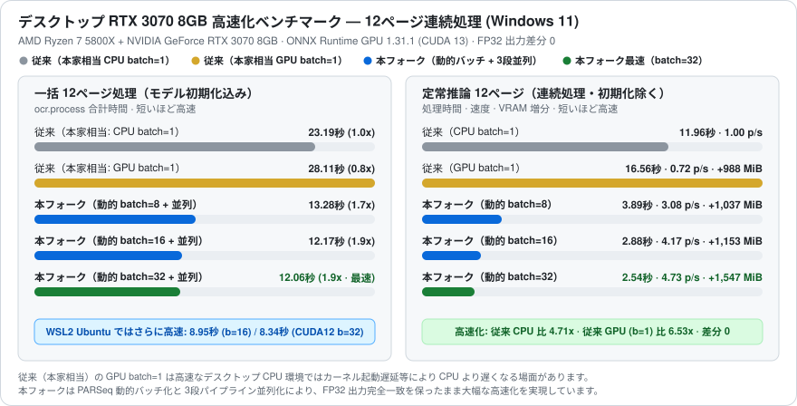
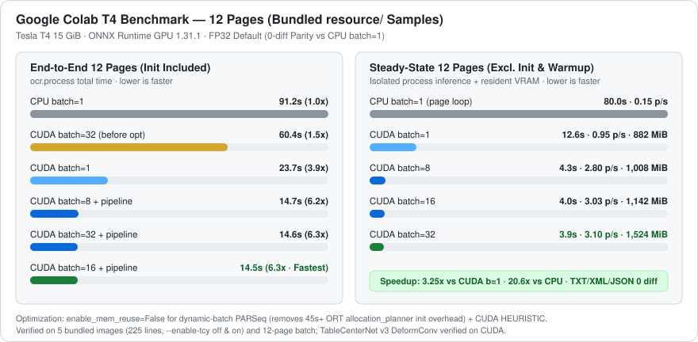
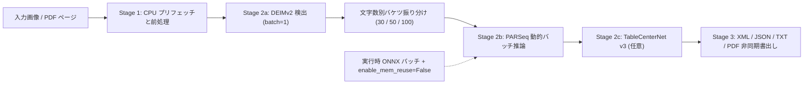

# ndlocr-lite-gpu

[](https://github.com/melmaron/ndlocr-lite-gpu/actions/workflows/ci.yml)
[](https://github.com/melmaron/ndlocr-lite-gpu/actions/workflows/build-flet-cross.yml)
[](https://github.com/ndl-lab/ndlocr-lite)
[](./LICENCE)

[ndl-lab/ndlocr-lite](https://github.com/ndl-lab/ndlocr-lite)（国立国会図書館公開、v2.0.0 / CC BY 4.0）をベースにした非公式フォークリポジトリです（国立国会図書館および NDLラボとは関係ありません）。

元のリポジトリに以下の機能を追加しています。

- **マルチベンダー GPU 対応**: NVIDIA CUDA に加え、AMD Radeon（MIGraphX / ROCm / WebGPU）や Intel Arc（OpenVINO / WebGPU）での推論に対応
- **PARSeq 動的バッチ推論**: 実行時に ONNX モデルを動的バッチ化し、FP32 のまま CPU `batch=1` と出力完全一致（XML / JSON / TXT 差分 0）を保って高速化
- **3 段パイプライン並列化**: 画像の前処理・GPU 推論・ファイル書き出しを並列化し、複数ページ / PDF 処理のスループットを改善
- **GUI からのデバイス切り替え**: デスクトップ GUI の出力設定に実行環境・GPU 設定を追加し、稼働バックエンド表示と安全な再読み込みに対応

本フォーク固有の GPU 対応・動的バッチ処理に関する不具合は、本リポジトリの Issue へお願いします。

---

## ダウンロード

GUI デスクトップアプリケーションのビルド済みパッケージは、**[Releases ページ](https://github.com/melmaron/ndlocr-lite-gpu/releases)** からダウンロードできます）。

| OS | GPU / 環境 | ダウンロード対象ファイル名 | 同梱内容・別途必要な環境（前提条件） |
|---|---|---|---|
| **Windows** | NVIDIA GPU (CUDA) | `ndlocr_lite_gpu_v*_windows_cuda.zip` | **CUDA 13 + cuDNN 9 + VC++ ランタイム同梱**（CUDA Toolkit 別途導入不要・容量目安 ~1.25 GB）。CUDA 13 対応 NVIDIA ドライバ（R580 以降）のみ必要 |
| **Windows** | AMD Radeon / Intel Arc / その他 | `ndlocr_lite_gpu_v*_windows_gpu_generic.zip` | **WebGPU / OpenVINO / DXC / TBB / VC++ ランタイム同梱**。DirectX 12 対応ドライバのみ必要（注意: NVIDIA GPU では WebGPU の DXC コンパイル失敗で CPU に落ちる場合があり、`cuda` 版を推奨） |
| **Linux** | NVIDIA GPU (CUDA) | `ndlocr_lite_gpu_v*_linux_cuda.tar.gz` | **CUDA 13 + cuDNN 9 ランタイム同梱**（CUDA Toolkit 別途導入不要・容量目安 ~1.55 GB）。CUDA 13 対応 NVIDIA ドライバ（R580 以降）、GTK3 (`libgtk-3-0`)・glibc 2.35 以上（Ubuntu 22.04 以降目安）が必要 |
| **Linux** | AMD Radeon / Intel Arc / その他 | `ndlocr_lite_gpu_v*_linux_gpu_generic.tar.gz` | **WebGPU / OpenVINO / TBB ランタイム同梱**。Vulkan (`libvulkan.so.1`) + GPU ドライバ、GTK3・glibc 2.35 以上が必要（OpenVINO は x86_64 のみ・ARM64 は WebGPU のみ） |

> [!NOTE]
> - 展開後のフォルダは **日本語（全角文字）を含まないパス**（例: `C:\ndlocr-lite\`）に配置して起動してください。
> - **ランタイム同梱とフォールバック診断**: `cuda` 版は CUDA 13 + cuDNN 9 ランタイムを、Windows 版一式は不足しやすい VC++ ランタイム DLL（`msvcp140_1.dll`, `msvcp140_atomic_wait.dll` 等）をパッケージ内に同梱しているため、GPU ドライバのみあれば展開後すぐ利用できます（そのため `cuda` 版のアーカイブ容量は約 1.2〜1.6 GB となります）。ドライバ未導入・旧版・非対応 GPU 等で CPU へフォールバックした場合は、画面上部の警告バナー・「環境診断」ダイアログ・ログファイル (`ndlocr-lite.log`) に分かりやすい原因と対処法が表示されます。
> - **AMD MIGraphX / ROCm**: 配布バイナリには含まれず、Linux ROCm 環境でのソース導入限定です（配布パッケージの AMD GPU は `gpu_generic` / WebGPU を利用）。
> - CLI 版や Python ソースから直接実行したい場合は、下の [セットアップと使い方](#セットアップと使い方) を参照してください。

---

## 本家との違い

v2.0.0 標準の PDF 入出力・縦中横 (`--enable-tcy`)・表構造認識 (`TableCenterNet`)・Flet GUI はそのまま引き継ぎつつ、推論バックエンドとパイプラインを拡張した。

| 項目 | 本家 `ndl-lab/ndlocr-lite` v2.0.0 | 本フォーク (`ndlocr-lite-gpu`) |
|---|---|---|
| **推論デバイス (`--device`)** | `cpu`（既定）または `cuda` の 2 択 | `auto`（既定）で `cuda > migraphx > rocm > openvino > webgpu > dml > cpu` を自動選択。失敗時は `cpu` へフォールバック（`--strict-device` / `--check-device` 対応） |
| **AMD Radeon / Intel Arc** | 非対応 | ONNX Runtime `1.31.1` + Plugin EP（`webgpu` / `openvino`）および Linux ROCm（`migraphx` / `rocm`）に対応。**TableCenterNet (`DeformConv`)** も汎用 GPU 上で動作 |
| **PARSeq 文字認識** | 静的 `batch=1` の逐次推論 | 実行時に ONNX グラフを動的バッチ軸へパッチし、`--batch-size`（既定 CUDA `64` / MIGraphX・ROCm `32` / 汎用 GPU `16`）でバッチ推論。`enable_mem_reuse=False`・sidecar キャッシュ・並列セッション初期化＋warm-up により初期化・推論遅延を解消 |
| **複数画像 / PDF 処理** | ページ単位の逐次実行 | `[前処理プリフェッチ / PDF 1回オープン (CPU)] → [検出 + 3段認識 + 表解析 (GPU)] → [XML/JSON/TXT/可視化PNG並列/PDF 非同期書出し (CPU)]` の **3 段パイプライン並列化**（CLI・GUI 共通） |
| **デスクトップ GUI** | デバイス固定 | 出力設定に「実行環境・GPU高速化」（デバイス・バッチサイズ・推論精度・環境診断）と常時編集可能な PDF 入出力解像度設定を追加。可視化画像保存のチェック状態を保持し、画面上部に稼働バックエンドとフォールバック警告バナーを表示し、`ndlocr-lite.log` へ診断ログを記録 |
| **認識精度と出力互換** | FP32 逐次基準 | **FP32 既定精度を維持**（5 画像・3p PDF 等で CPU `batch=1` と差分 0。複数ページ PDF も認識文字列・座標・読み順が一致し、`TEXTBLOCK CONF` のみ EP 間で 0.001 差が出うる）。オプションの `--precision fp16` で PARSeq 混合精度 FP16（高速・省 VRAM だが近似精度モードのため、特に長行 `rec100` や `--enable-tcy` で文字差が出うる）を選択可能 |
| **ビルド / CI** | 標準配布構成 | `ci.yml`（Win/Linux × Python 3.11/3.12 自動テスト）＋ `build-flet-cross.yml`（Win/Linux の `cuda`・`gpu-generic` 4 ターゲットビルド＋成果物検証） |

---

## ベンチマーク

### デスクトップ NVIDIA GeForce RTX 3070 8GB (Windows 11 / WSL2 Ubuntu)

AMD Ryzen 7 5800X + NVIDIA GeForce RTX 3070 (`8192 MiB`, ドライバ `617.42`, Python `3.12.16`) 実機で、同梱 `resource/` 画像を循環させた **12 ページ連続処理**を計測した結果です（詳細条件と再現手順は [GPU セットアップガイド](./docs/GPU_SETUP.md) 第 5 節）。

<p align="center">
  <picture>
    <source media="(prefers-color-scheme: dark)" srcset="./docs/assets/benchmark-rtx3070-dark.svg">
    
  </picture>
</p>

| 環境 / モード | ORT 版 | 一括 12p (初期化込) | 一括速度 | 定常 12p (初期化・warmup 除) | 定常速度 | VRAM 増分 (定常) |
|---|---|---|---|---|---|---|
| Windows 11 / CPU `batch=1`（従来相当） | `1.31.1` | 23.190 秒 | 0.517 p/s | 11.961 秒 | 1.003 p/s | — |
| Windows 11 / CUDA 13 `batch=1`（従来相当） | `1.31.1` | 28.108 秒 | 0.427 p/s | 16.563 秒 | 0.724 p/s | +988 MiB |
| Windows 11 / CUDA 13 動的 `batch=8` + 並列 | `1.31.1` | 13.279 秒 | 0.904 p/s | 3.893 秒 | 3.082 p/s | +1,037 MiB |
| Windows 11 / CUDA 13 動的 `batch=16` + 並列 | `1.31.1` | 12.171 秒 | 0.986 p/s | 2.875 秒 | 4.173 p/s | +1,153 MiB |
| Windows 11 / CUDA 13 動的 `batch=32` + 並列 | `1.31.1` | **12.055 秒** | **0.995 p/s** | **2.537 秒** | **4.730 p/s** | +1,547 MiB |
| Windows 11 / CUDA 12 動的 `batch=32` + 並列 | `1.29.0` | 12.626 秒 | 0.950 p/s | 3.019 秒 | 3.975 p/s | +1,607 MiB |
| Windows 11 / DML ハイブリッド `batch=32` | `1.24.4` | 27.901 秒 | 0.430 p/s | 17.114 秒 | 0.701 p/s | +598 MiB |
| WSL2 Ubuntu / CPU `batch=1`（従来相当） | `1.31.1` | 19.452 秒 | 0.617 p/s | 14.856 秒 | 0.808 p/s | — |
| WSL2 Ubuntu / CUDA 13 動的 `batch=16` + 並列 | `1.31.1` | **8.946 秒** | **1.341 p/s** | 2.943 秒 | 4.077 p/s | +1,331 MiB |
| WSL2 Ubuntu / CUDA 13 動的 `batch=32` + 並列 | `1.31.1` | 9.509 秒 | 1.262 p/s | **2.794 秒** | **4.295 p/s** | +1,613 MiB |
| WSL2 Ubuntu / CUDA 12 動的 `batch=32` + 並列 | `1.29.0` | **8.340 秒** | **1.439 p/s** | 3.047 秒 | 3.939 p/s | +1,561 MiB |

- **従来版に対する大幅な高速化**: 高速なデスクトップ CPU 環境では従来の `CUDA batch=1`（定常 `16.563 秒`）は `CPU batch=1`（`11.961 秒`）より遅くなることがありましたが、本フォークの動的バッチ＋3段パイプラインにより Windows 11 で **定常 `2.537 秒`（従来 CPU 比 4.71x、従来 GPU 比 6.53x）**、一括 12p でも **`12.055 秒`（WSL2 では最短 `8.340 秒`）** まで短縮しています
- **VRAM 節約と速度のバランス**: `--batch-size 16` でも Windows 11 で定常 `4.173 p/s`・WSL2 で一括 `8.946 秒` と高い性能を維持しつつ VRAM 増分を約 `280〜400 MiB` 抑えられるため、4 GB 級 VRAM GPU にも向きます
- **出力一致と各バックエンド検証**: Windows 11 / WSL2 の CUDA 13 (`ORT 1.31.1`)・CUDA 12 (`ORT 1.29.0`)・DirectML ハイブリッド (`ORT 1.24.4`: `DEIM CPU + PARSeq DML`) のすべてで、同梱 5 画像（通常・`--enable-tcy`）および 3 ページ PDF E2E の CPU `batch=1` 完全一致（差分 0）を確認済みです（`TableCenterNet v3` の CUDA 動作・同一 3 セル出力も検証済み）

<details>
<summary>参考実測: クラウド環境 Google Colab T4 Standard (Tesla T4 15GB)</summary>

Google Colab T4 Standard（`Tesla T4 15360 MiB`、NVIDIA driver `580.82.07`、`Python 3.13.16`、`onnxruntime-gpu==1.31.1`）上で、同梱 `resource/` 画像を循環させた **12 ページ連続処理**を計測した結果（詳細条件と再現手順は [GPU セットアップガイド](./docs/GPU_SETUP.md) 第 5 節）。

<p align="center">
  <picture>
    <source media="(prefers-color-scheme: dark)" srcset="./docs/assets/benchmark-t4-dark.svg">
    
  </picture>
</p>

| モード | 一括 12p (`ocr.process`, 初期化込) | 一括速度 | 定常 12p (初期化・warmup 除) | 定常速度 | プロセス VRAM |
|---|---|---|---|---|---|
| CPU `batch=1` | 91.245 秒 | 0.132 p/s | 79.967 秒 (`*`) | 0.150 p/s | — |
| CUDA `batch=32` (最適化前参考) | 60.364 秒 | 0.199 p/s | — | — | — |
| CUDA `batch=1` | 23.683 秒 | 0.507 p/s | 12.598 秒 | 0.953 p/s | 882 MiB |
| CUDA 動的バッチ `8` + パイプライン | 14.671 秒 | 0.818 p/s | 4.294 秒 | 2.795 p/s | 1,008 MiB |
| CUDA 動的バッチ `16` + パイプライン | **14.477 秒** | **0.829 p/s** | 3.966 秒 | 3.026 p/s | 1,142 MiB |
| CUDA 動的バッチ `32` + パイプライン | 14.595 秒 | 0.822 p/s | **3.876 秒** | **3.096 p/s** | 1,524 MiB |

`*` CPU `batch=1` の定常欄は `ocr.process` 内 12 ページの純粋処理合計（モデル初期化 11.369 秒は独立計測）。

- **初期化遅延の解消**: ORT 既定の `mem_reuse=True` が展開済みデコーダの動的テンソル計画に 45 秒以上費やしていた問題を `enable_mem_reuse=False` で抑え、一括 12p の `batch=32` を `60.364 秒 → 14.595 秒`（**4.14x 高速化**）に短縮
- **定常推論の高速化**: モデル初期化を除いた定常推論では `batch=32` が `3.876 秒`（CUDA `batch=1` 比 **3.25x**、CPU 比約 **20.6x**）。`--batch-size 16` でも定常速度の約 98%（`3.026 p/s`）・一括最速（`14.477 秒`）を保ちつつ VRAM を `382 MiB` 抑えられるため、4 GB 級 VRAM GPU にも向く
- **出力一致と TableCenterNet 検証**: 同梱 `resource/` 5 画像（225 行、`--enable-tcy` off/on 双方）および 12 ページ一括で、CUDA 動的バッチと `CPU batch=1` の TXT / XML / JSON 出力が完全一致（差分 0）。TableCenterNet v3（`DeformConv`）も CUDA 上で CPU フォールバックなしに同一セル数（合成表 3 セル）を確認済み

</details>

---

## 対応 GPU とバックエンド

ドライバ条件や CUDA 12 / 13 系インデックスの使い分けは **[GPU セットアップガイド](./docs/GPU_SETUP.md)** を参照してください。

| `--device` | Execution Provider | 対象 GPU / OS | 既定バッチ | TableCenterNet (`DeformConv`) | 要件ファイル |
|---|---|---|---|---|---|
| `auto` (既定) | 自動判定 | `CUDA > MIGraphX > ROCm > OpenVINO > WebGPU > DML > CPU` の優先順で自動選択（ソフトウェア/仮想 WebGPU は除外、不可時は `cpu`） | バックエンド準拠 | EP 準拠 | 用途に応じて選択 |
| `cuda` | `CUDAExecutionProvider` | NVIDIA GPU (Windows / Linux、CUDA 13 + cuDNN 9 必須・Ampere+ 互換のため `use_tf32=0` 自動適用) | `64` | 対応 (ORT 1.31.1 / 1.29.0) | [`requirements-cuda.txt`](./requirements-cuda.txt) |
| `migraphx` | `MIGraphXExecutionProvider` | AMD Radeon (Linux ROCm 6.x+、**ソース導入限定**) | `32` | 対応 (ORT 1.27.1) | [`requirements-migraphx.txt`](./requirements-migraphx.txt) |
| `rocm` | `ROCMExecutionProvider` | AMD Radeon (Linux ORT-ROCm、**ソース導入限定**) | `32` | 要 ORT >= 1.25 | 別ビルド ORT-ROCm |
| `openvino` | `OpenVINOExecutionProvider` (`GPU`) | Intel Arc / Intel 内蔵 GPU (Win / Linux **x86_64 限定**) | `16` | 対応 (Plugin EP + ORT 1.31.1) | [`requirements-gpu-generic.txt`](./requirements-gpu-generic.txt) |
| `webgpu` | `WebGpuExecutionProvider` | AMD Radeon / Intel Arc / NVIDIA 他 (Win D3D12 / Linux `libvulkan.so.1`、Win+NVIDIA は DXC エラーで CPU 落ちあり) | `16` | 対応 (Plugin EP + ORT 1.31.1) | [`requirements-gpu-generic.txt`](./requirements-gpu-generic.txt) |
| `dml` | `DmlExecutionProvider` | Windows DirectX 12 GPU（`DEIMv2` は自動 CPU フォールバック、`PARSeq` のみ DML GPU） | `16` | **非対応** (`1.24.4` 制約・自動無効化) | `onnxruntime-directml==1.24.4` |
| `cpu` | `CPUExecutionProvider` | 全環境（配布バイナリは Win/Linux；macOS はソース CPU のみ・CoreML 未対応） | `1` | ORT >= 1.25 で対応（`1.23.2` 等は無効） | [`requirements.txt`](./requirements.txt) |

---

## セットアップと使い方

### 1. CLI 環境構築と実行

Python 3.11 以上が必要です（GUI 版は Python 3.13 まで）。

> **注意**: `onnxruntime`（CPU / Plugin EP 用）と `onnxruntime-gpu` は同一パッケージ名空間を上書きするため、同じ仮想環境に混在させないでください。CUDA へ切り替える際は先に `pip uninstall -y onnxruntime` を実行してください。

```bash
git clone https://github.com/melmaron/ndlocr-lite-gpu.git
cd ndlocr-lite-gpu
python3 -m venv .venv
source .venv/bin/activate   # Windows PowerShell: .venv\Scripts\Activate.ps1
```

お使いの GPU に合わせていずれかの依存パッケージをインストールします。

```bash
# A) 汎用 GPU（AMD Radeon / Intel Arc: WebGPU + OpenVINO Plugin EP, ORT 1.31.1 維持）
pip install -r requirements-gpu-generic.txt

# B) NVIDIA CUDA 13 系環境（CUDA 13 + cuDNN 9 ランタイム wheel も自動導入）
pip uninstall -y onnxruntime && pip install -r requirements-cuda.txt

# C) NVIDIA CUDA 12 系環境（Google Colab 等。Windows で cudnn64_9.dll が見つからない場合は nvidia-cudnn-cu12 も追加）
pip uninstall -y onnxruntime && pip install -r requirements.txt
pip install --force-reinstall --no-deps \
  --index-url https://aiinfra.pkgs.visualstudio.com/PublicPackages/_packaging/onnxruntime-cuda-12/pypi/simple/ \
  onnxruntime-gpu==1.29.0

# D) AMD Radeon Linux ROCm 環境（MIGraphX）
pip uninstall -y onnxruntime && pip install -r requirements-migraphx.txt

# E) 標準 CPU 環境（または `ndlocr-lite` コマンドを uv で導入する場合）
pip install -r requirements.txt
# uv tool install .
```

利用可能な Execution Provider と選択結果を確認したうえで、OCR を実行します。

```bash
# 1. 利用可能デバイス診断
python3 src/ocr.py --check-device

# 2. ディレクトリ一括 OCR（--device auto で利用可能な GPU を自動選択）
python3 src/ocr.py --sourcedir input_images --output out_dir

# 3. WebGPU 明示・VRAM 節約のためバッチサイズ 16 指定
python3 src/ocr.py --sourceimg resource/digidepo_2531162_0024.jpg --output out_dir --device webgpu --batch-size 16

# 4. フォールバック禁止で CUDA + 縦中横有効化
python3 src/ocr.py --sourcedir input_images --output out_dir --device cuda --strict-device --enable-tcy

# 5. PDF から透明テキスト付き PDF を生成
python3 src/ocr.py --sourcepdf input.pdf --output out_dir --pdf-output out_dir/out_text.pdf
```

<details>
<summary>主な CLI オプション一覧（本フォーク追加オプション含む）</summary>

| オプション | 既定値 | 説明 |
|---|---|---|
| `--device` | `auto` | `[追加]` 推論デバイス (`auto`, `cuda`, `migraphx`, `rocm`, `openvino`, `webgpu`, `dml`, `cpu`) |
| `--device-id` | `0` | `[追加]` マルチ GPU 環境でのデバイスインデックス |
| `--batch-size` | CUDA=`64`, MIGraphX/ROCm=`32`, OpenVINO/WebGPU/DML=`16`, CPU=`1` (`0`=自動) | `[追加]` PARSeq 動的バッチ認識の最大バッチサイズ上限 |
| `--precision` | `fp32` | `[追加]` PARSeq の推論精度（`fp32`: 厳密既定値 / `fp16`: GPU 向けの高速・省 VRAM **近似**モード。`fp32` と文字が完全一致しない場合があり、特に `rec100` 長行・`--enable-tcy` で微小差が出うる。CPU 実行時は `fp32` へ自動フォールバックし、DEIMv2 と TableCenterNet は FP32 固定） |
| `--strict-device` | 無効 | `[追加]` 指定 GPU バックエンドの初期化・実行失敗時に CPU へフォールバックせず終了 |
| `--check-device` | 無効 | `[追加]` 利用可能な EP・検出 GPU デバイス一覧・`--device auto` の選択結果を表示して終了 |
| `--sourcedir` | — | 入力画像ディレクトリ (`jpg/jpeg/png/tiff/tif/jp2/bmp/webp` および PDF) |
| `--sourceimg` | — | 単一入力画像のパス |
| `--sourcepdf` | — | 単一入力 PDF のパス |
| `--output` | 必須 (`--check-device` 時除く) | XML / JSON / TXT 等の出力先ディレクトリ（親ディレクトリ含め自動作成） |
| `--viz` | `False` | `--viz True` で検出箇所の可視化画像を保存 |
| `--json-only` | 無効 | `.xml` / `.txt` を出力せず JSON のみ保存 |
| `--enable-tcy` | 無効 | 縦書き資料向けの縦中横読み取りを有効化 |
| `--pdf-output` | — | 透明テキスト埋め込み PDF の出力パス |
| `--pdf-render-dpi` | `150.0` | PDF ページのレンダリング解像度 DPI |
| `--pdf-page-output` | 有効 (`--no-pdf-page-output` で無効) | 複数ページ PDF でページごとの TXT / JSON / XML を出力 |
| `--pdf-visible-text` | 無効 | デバッグ用に PDF テキスト層を青字で可視描画 |

</details>

<details>
<summary>モデルおよび動的バッチパッチのキャッシュ保存先</summary>

- リポジトリ直下から `python3 src/ocr.py` を実行する場合は同梱の `src/model/` を使用します。パッケージ導入時（`ndlocr-lite`）は初回実行時にモデルを取得してローカルにキャッシュします。
- モデルキャッシュ先:
  - Windows: `%LOCALAPPDATA%\ndlocr-lite\models\v2`
  - macOS: `~/Library/Caches/ndlocr-lite/models/v2`
  - Linux: `${XDG_CACHE_HOME:-~/.cache}/ndlocr-lite/models/v2`
- PARSeq 動的バッチ／FP16 パッチ済みモデル（`*_dynbatch_{fp32|fp16}_v1.onnx` と対応 `.meta.json` sidecar）は上記キャッシュ配下の `optimized/`（環境変数 `NDLOCR_CACHE_DIR` 指定時は `$NDLOCR_CACHE_DIR/optimized/`）へ保存されます。

</details>

### 2. デスクトップアプリケーション（GUI）

> **注意**: デスクトップアプリケーションは、日本語（全角文字）を含まないパスに配置してください。全角文字を含むパスでは起動しないことがあります。

- **ソースから起動**: パッケージ導入後に `ndlocr-lite gui` で起動します（または `ndlocr-lite-gui/main.py` を実行）。
- **配布ビルド**: GitHub Actions [`build-flet-cross.yml`](./.github/workflows/build-flet-cross.yml) で、Windows / Linux（各 `cuda` と `gpu-generic`）の **4 ターゲット** をビルドしています（macOS は非提供）。
- **起動時診断とログ**: GPU バックエンドの有効化に失敗して CPU へフォールバックした場合、画面上部の警告バナーと「環境診断」ボタンから不足ライブラリ名と対処法を確認でき、詳細ログはアプリデータディレクトリ内の `ndlocr-lite.log` に保存されます。
- ビルド手順の詳細は [ndlocr-lite-gui/README.md](./ndlocr-lite-gui/README.md)、GUI の基本操作は上流の [NDLOCR-Liteの使い方](https://lab.ndl.go.jp/data_set/ndlocrlite-usage/) を参照してください（本フォークでは **出力設定ダイアログ →「実行環境・GPU高速化」** にデバイス・バッチサイズ・推論精度・「環境診断」を設定できます）。

---

## 高速化の仕組み



1. **PARSeq 実行時動的バッチパッチと初期化遅延・精度ずれの解消**
   上流の PARSeq 3 モデル（`24x256-30` / `24x384-50` / `24x768-100`）は静的 `batch=1` 構成。初回ロード時にバッチ軸 (`N`) を動的化したキャッシュ（`*_dynbatch_{fp32|fp16}_v1.onnx` と BLAKE2b 検証付き sidecar）を生成し、`batch=1` との数値一致を検証した上でバッチ推論する（破損や異常時は自動再構築または `batch=1` へフォールバック）。動的バッチ時は ORT の `enable_mem_reuse=False` と CUDA `cudnn_conv_algo_search="HEURISTIC"` を指定して数十秒の初期化停滞を防ぎ、さらに `"use_tf32": "0"` を明示して Ampere+ GPU での TF32 精度ずれも抑止している。なお `--precision fp16` は高速・省 VRAM 向けの近似モードのため、`fp32` と完全に同じ文字列にはならない場合がある（特に `rec100` や `--enable-tcy`）。
2. **3 段パイプライン並列化**
   複数画像・PDF の処理では、次ページの画像デコードと DEIM 前処理をバックグラウンドスレッドで先読みし、出力書き出しも非同期スレッドへ逃がして GPU の待ち時間を減らしている。
3. **Plugin EP と自動ガードによる安全なバックエンド選択**
   旧来の `onnxruntime-directml==1.24.4` は ORT >= 1.25 要件の TableCenterNet (`DeformConv`) に非対応なうえ DEIMv2 推論でバウンディングボックス破損を起こすため、DML 時は `DEIMv2` を自動で `cpu` へフォールバックさせ `PARSeq` のみ DML GPU で動作するよう保護した。また `onnxruntime==1.31.1` 上の `onnxruntime-ep-webgpu` / `onnxruntime-ep-openvino` 利用時は、Intel GPU 非搭載機での OpenVINO 誤選択および WSL2 仮想アダプタ (`0x1414`) や Mesa `llvmpipe` (`0x10005`) の `--device auto` 誤選択を防いでいる。設計詳細は [docs/GPU_SETUP.md](./docs/GPU_SETUP.md) を参照。

---

## 検証状況

ローカル環境でのテスト実行:

```bash
PYTHONPATH=src:ndlocr-lite-gui .venv/bin/pytest tests ndlocr-lite-gui/tests -v
```

- **ローカル・実機自動テスト（`Python 3.12.16`）**:
  - **ローカル Linux（最新）**: **124 passed（+ 103 subtests）**
  - **実機 Windows 11 / WSL2 Ubuntu（`c0eec1a` 時点）**: Windows 11 **100 passed, 1 skipped（+ 63 subtests）**（Windows NTFS で使用不可文字を含む POSIX ファイル名テストをスキップ） / WSL2 Ubuntu **101 passed（+ 67 subtests）**
- **GitHub Actions CI（[ci.yml](./.github/workflows/ci.yml)）**: 履歴スナップショット（コミット `17222a9`）で全 4 ジョブ通過（`ubuntu-latest` `98 passed (+ 67 subtests)` / `windows-latest` `97 passed, 1 skipped (+ 63 subtests)`）
- **GitHub Actions クロスビルド（[build-flet-cross.yml](./.github/workflows/build-flet-cross.yml)）**: Windows `cuda` / `gpu-generic`、Linux `cuda` / `gpu-generic` の 4 ターゲットを成果物内容検証付きでビルド・公開（`2.0.0` 初回公開時のみ macOS 2 ターゲットも生成されていましたが実機未検証のため廃止）
- **実機 E2E 検証（RTX 3070 8GB: Windows 11 / WSL2 Ubuntu）および Plugin EP 検証**:
  - Windows 11 / WSL2 双方で CUDA 13 (`ORT 1.31.1` + pip CUDA 13 runtime wheel) と CUDA 12 (`ORT 1.29.0`)、および Windows DirectML ハイブリッド (`ORT 1.24.4`: `DEIM CPU + PARSeq DML`) を検証し、5 画像（通常・`--enable-tcy`）と 3 ページ PDF E2E の全てで CPU `batch=1` 完全一致（差分 0）を確認済み
  - WSL2 仮想 WebGPU アダプタ (`vid=0x1414`) の `auto` スキップ・`--device webgpu` 強制時の警告、Windows `onnxruntime-ep-webgpu==0.6.0` の DXC コンパイルエラー時 CPU フォールバック、および汎用 Linux Vulkan GPU 上の WebGPU 実機推論を確認済み
- **CUDA 環境 / Google Colab 再現ベンチマーク**:
  ```bash
  python3 scripts/colab_verify_gpu.py --pages 12 --json-out colab_gpu_report.json
  ```

---

## ライセンスとクレジット

- **上流プロジェクト**: [ndl-lab/ndlocr-lite](https://github.com/ndl-lab/ndlocr-lite)（v2.0.0、国立国会図書館 [NDLラボ](https://lab.ndl.go.jp/)）
- **主な改変箇所**: マルチベンダー GPU バックエンド統合 (`ort_provider`)、PARSeq 実行時動的バッチパッチとセッション初期化最適化 (`onnx_batch_patcher` / `parseq`)、3 段パイプライン化とファイル名エスケープ・並列・キャッシュ堅牢化 (`ocr` / `ndl_parser` / `tablecenternet`)、GUI 実行エンジン設定と遅延リロード制御 (`ndlocr-lite-gui`)、クロスビルド・CI 構成および関連ドキュメントの追加
- **ライセンス**: 上流と同一の **CC BY 4.0**（[LICENCE](./LICENCE) / 依存ライブラリは [LICENCE_DEPENDENCEIES](./LICENCE_DEPENDENCEIES)）
- **モデルに関する注意**: レイアウト認識モデルのバックボーンには DINOv3 を蒸留した ViT-Tiny モデルが使われています。学習済モデルを利用する場合は [DINOv3 ライセンス](https://github.com/facebookresearch/dinov3/blob/main/LICENSE.md) の条項も遵守してください
- **学習手順・基本資料**: 再学習手順は [train/README.md](./train/README.md)、オリジナルの OCR 結果サンプルや精度評価は [ndl-lab/ndlocr-lite](https://github.com/ndl-lab/ndlocr-lite) を参照してください
